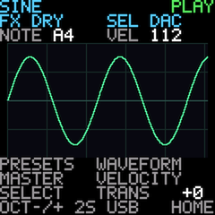

# FM-1 Rust

The [`fm1` crate](fm1/) is a bare-metal Rust board support package for the
M-VAVE FM-1 synthesizer. It runs on CPU0 of the JieLi AC791N, uses
`embedded-hal` 1.0 and needs no allocator.

## Waveform demo

The [`rticx-waveform` example](fm1-rticx/examples/rticx-waveform.rs) scans the
front panel and streams stereo audio via DMA while an async RTICX task plots
the samples on the LCD. Tap a piano key to set the pitch and turn **PRESETS**
to cycle through sine, triangle, sawtooth and square waves. With **SEL DAC**
on screen, press **FX** to halve the output level and watch the trace shrink.

[][example-tour]

*LCD capture from [fm1-emu](https://github.com/joakimeriksson/fm1-emu).* [Check out `fm1-rticx` examples for more advanced functionality][example-tour], or [WaveGraph] for an advanced pure Rust DSP application built on `fm1-rticx`.

[Build the example locally](fm1-rticx/README.md#examples) or get
`rticx-waveform.fwsc` from the `fm1-rticx-firmware` artifact on a
[successful CI run][fm1-rticx-ci].

## Crates

| Crate | Description | crates.io | Documentation | Build status |
| --- | --- | --- | --- | --- |
| [`fm1`](fm1/) | Board support and peripheral drivers | [![crates.io][fm1-version]][fm1-crate] | [![docs.rs][fm1-docs-badge]][fm1-docs] | [![Build status][fm1-build]][fm1-ci] |
| [`fm1-audio`](fm1-audio/) | Stereo output, master gain and interrupt timing | [![crates.io][fm1-audio-version]][fm1-audio-crate] | [![docs.rs][fm1-audio-docs-badge]][fm1-audio-docs] | [![Build status][fm1-audio-build]][fm1-audio-ci] |
| [`fm1-cli`](fm1-cli/) | The `fm1` command for USB logs and timing reports | — | — | [![Build status][fm1-cli-build]][fm1-cli-ci] |
| [`fm1-controls`](fm1-controls/) | Front-panel input and async scan delivery | [![crates.io][fm1-controls-version]][fm1-controls-crate] | [![docs.rs][fm1-controls-docs-badge]][fm1-controls-docs] | [![Build status][fm1-controls-build]][fm1-controls-ci] |
| [`fm1-graphics`](fm1-graphics/) | Text grids and waveform plots over the BSP display | [![crates.io][fm1-graphics-version]][fm1-graphics-crate] | [![docs.rs][fm1-graphics-docs-badge]][fm1-graphics-docs] | [![Build status][fm1-graphics-build]][fm1-graphics-ci] |
| [`fm1-rticx`](fm1-rticx/) | RTICX tasks and clocks for the FM-1 | [![crates.io][fm1-rticx-version]][fm1-rticx-crate] | [![docs.rs][fm1-rticx-docs-badge]][fm1-rticx-docs] | [![Build status][fm1-rticx-build]][fm1-rticx-ci] |
| [`fm1-usb`](fm1-usb/) | Host USB discovery, bidirectional MIDI and log snapshots | — | — | [![Build status][fm1-usb-build]][fm1-usb-ci] |
| [`rticx-pi32v2`](rticx-pi32v2/) | RTICX runtime for AC791N CPU0 | [![crates.io][pi32v2-version]][pi32v2-crate] | [![docs.rs][pi32v2-docs-badge]][pi32v2-docs] | [![Build status][pi32v2-build]][pi32v2-ci] |
| [`rticx-pi32v2-macro`](rticx-pi32v2-macro/) | Application macros for the pi32v2 runtime and FM-1 board crate | [![crates.io][macro-version]][macro-crate] | [![docs.rs][macro-docs-badge]][macro-docs] | [![Build status][pi32v2-build]][pi32v2-ci] |

## Examples

The BSP builds on Julius Vitkauskas’s [`fm1-blink-rust` proof of concept][blink-origin].
His example demonstrated the timer-driven PLAY LED, the ST7789 display and a
return to USB download mode on a physical FM-1.

| Example | What to look or listen for |
| --- | --- |
| [`blink`](fm1/examples/blink.rs) | The PLAY LED turns on for half a second and off for half a second. |
| [`cpu1-probe`](fm1/README.md#cpu1-boot-probe) | Runs a Rust computation on the second core at boot and reports the result on PLAY. |
| [`display`](fm1/examples/display.rs) | Three vertical bars fill the screen in red, green and blue. |
| [`graphics`](fm1/examples/graphics.rs) | RGB swatches with the label ST7789. Hold PLAY at startup for the framebuffer version of the card. |
| [`tone`](fm1/examples/tone.rs) | A quiet, continuous square wave at about 441 Hz. |

The blink, display and tone examples have been observed on an FM-1 running M-Bootloader
`2.4-395E6CC`. Start with the [firmware build and flashing instructions](fm1/README.md#build-and-flash).

For interrupt-driven applications, [`fm1-rticx`](fm1-rticx/) adds priority-based
hardware and async tasks, shared resources and a 100 Hz clock. Its examples
schedule the PLAY LED and button independently, and refill audio DMA while
repainting the LCD.

For development on a host, run `cargo test --workspace --all-features` with a
standard Rust toolchain. Building firmware uses the community pi32v2 toolchain.
Downstream projects can cross-build with the [reusable GitHub Actions workflow](fm1/README.md#github-actions-ci).

The [USB OUT DMA investigation](docs/usb-dma/README.md) records the physical
FM-1 measurements, the receiver's safety requirements and how to reproduce them.

## License

Original code in the workspace crates is licensed under the [MIT License](fm1/LICENSE).
Julius Vitkauskas’s [blink example][blink-origin] is licensed under MIT-0.
The `fm1` BSP incorporates MPL-2.0 code from Felucca’s C headers and USB driver
and from the `fm1-base` piano touch library. See the [BSP license section](fm1/README.md#license)
for the upstream sources and credits.

[fm1-version]: https://img.shields.io/crates/v/fm1?logo=rust
[fm1-crate]: https://crates.io/crates/fm1
[fm1-docs-badge]: https://docs.rs/fm1/badge.svg
[fm1-docs]: https://docs.rs/fm1/
[fm1-build]: https://github.com/fm1-rust/fm1-rust/actions/workflows/fm1.yml/badge.svg?branch=main&event=push
[fm1-ci]: https://github.com/fm1-rust/fm1-rust/actions/workflows/fm1.yml
[fm1-audio-version]: https://img.shields.io/crates/v/fm1-audio?logo=rust
[fm1-audio-crate]: https://crates.io/crates/fm1-audio
[fm1-audio-docs-badge]: https://docs.rs/fm1-audio/badge.svg
[fm1-audio-docs]: https://docs.rs/fm1-audio/
[fm1-audio-build]: https://github.com/fm1-rust/fm1-rust/actions/workflows/fm1-audio.yml/badge.svg?branch=main&event=push
[fm1-audio-ci]: https://github.com/fm1-rust/fm1-rust/actions/workflows/fm1-audio.yml
[fm1-controls-version]: https://img.shields.io/crates/v/fm1-controls?logo=rust
[fm1-controls-crate]: https://crates.io/crates/fm1-controls
[fm1-controls-docs-badge]: https://docs.rs/fm1-controls/badge.svg
[fm1-controls-docs]: https://docs.rs/fm1-controls/
[fm1-controls-build]: https://github.com/fm1-rust/fm1-rust/actions/workflows/fm1-controls.yml/badge.svg?branch=main&event=push
[fm1-controls-ci]: https://github.com/fm1-rust/fm1-rust/actions/workflows/fm1-controls.yml
[fm1-graphics-version]: https://img.shields.io/crates/v/fm1-graphics?logo=rust
[fm1-graphics-crate]: https://crates.io/crates/fm1-graphics
[fm1-graphics-docs-badge]: https://docs.rs/fm1-graphics/badge.svg
[fm1-graphics-docs]: https://docs.rs/fm1-graphics/
[fm1-graphics-build]: https://github.com/fm1-rust/fm1-rust/actions/workflows/fm1-graphics.yml/badge.svg?branch=main&event=push
[fm1-graphics-ci]: https://github.com/fm1-rust/fm1-rust/actions/workflows/fm1-graphics.yml
[fm1-rticx-version]: https://img.shields.io/crates/v/fm1-rticx?logo=rust
[fm1-rticx-crate]: https://crates.io/crates/fm1-rticx
[fm1-rticx-docs-badge]: https://docs.rs/fm1-rticx/badge.svg
[fm1-rticx-docs]: https://docs.rs/fm1-rticx/
[fm1-rticx-build]: https://github.com/fm1-rust/fm1-rust/actions/workflows/fm1-rticx.yml/badge.svg?branch=main&event=push
[fm1-rticx-ci]: https://github.com/fm1-rust/fm1-rust/actions/workflows/fm1-rticx.yml
[example-tour]: fm1-rticx/README.md#example-tour
[wavegraph]: https://github.com/fm1-rust/wavegraph
[pi32v2-version]: https://img.shields.io/crates/v/rticx-pi32v2?logo=rust
[pi32v2-crate]: https://crates.io/crates/rticx-pi32v2
[pi32v2-docs-badge]: https://docs.rs/rticx-pi32v2/badge.svg
[pi32v2-docs]: https://docs.rs/rticx-pi32v2/
[pi32v2-build]: https://github.com/fm1-rust/fm1-rust/actions/workflows/rticx-pi32v2.yml/badge.svg?branch=main&event=push
[pi32v2-ci]: https://github.com/fm1-rust/fm1-rust/actions/workflows/rticx-pi32v2.yml
[macro-version]: https://img.shields.io/crates/v/rticx-pi32v2-macro?logo=rust
[macro-crate]: https://crates.io/crates/rticx-pi32v2-macro
[macro-docs-badge]: https://docs.rs/rticx-pi32v2-macro/badge.svg
[macro-docs]: https://docs.rs/rticx-pi32v2-macro/
[blink-origin]: https://github.com/jvitkauskas/pi32v2-isa/tree/701a76faf103d1889d9bdf67987b872899c27257/examples/fm1-blink-rust

[fm1-cli-build]: https://github.com/fm1-rust/fm1-rust/actions/workflows/fm1-cli.yml/badge.svg?branch=main&event=push
[fm1-cli-ci]: https://github.com/fm1-rust/fm1-rust/actions/workflows/fm1-cli.yml

[fm1-usb-build]: https://github.com/fm1-rust/fm1-rust/actions/workflows/fm1-usb.yml/badge.svg?branch=main&event=push
[fm1-usb-ci]: https://github.com/fm1-rust/fm1-rust/actions/workflows/fm1-usb.yml
